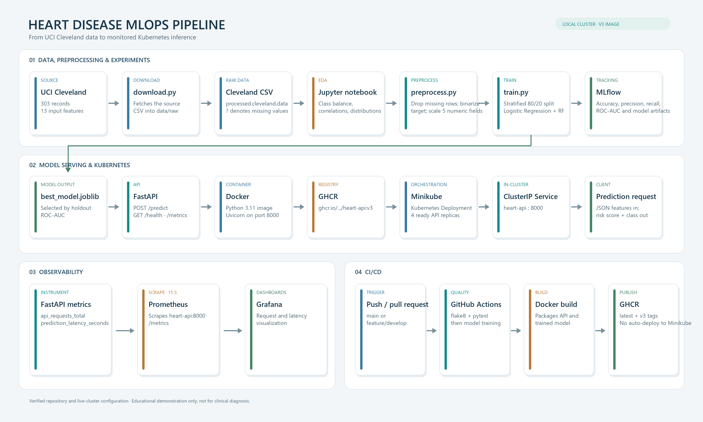
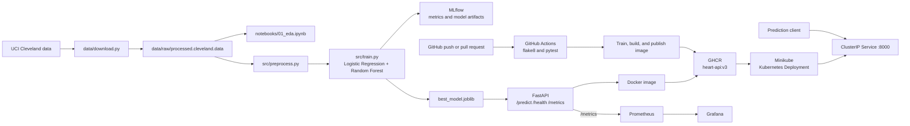
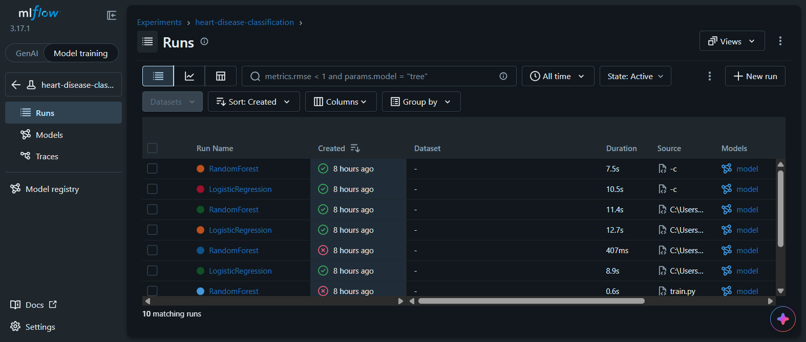

# MLOps Assignment 1: Heart Disease Prediction

**Student:** [Add your name]  
**Repository:** [Add the public GitHub repository URL]  
**Report date:** 20 October 2026

> Submission note: the architecture diagram is ready. Add the remaining screenshots, repository URL, and student name before submitting; do not submit with the checklist unresolved.

## 1. Project Overview

This project implements an end-to-end machine-learning workflow for the UCI Cleveland Heart Disease dataset. It downloads and explores the data, cleans and transforms it, compares two classifiers, logs experiments with MLflow, serves predictions through FastAPI, packages the service as a Docker image, and deploys it to Kubernetes on Minikube. Prometheus and Grafana are running in the cluster for monitoring.

The API returns a model-estimated probability and a binary prediction. It is an educational demonstration, not a clinical diagnostic tool.

## 2. Architecture





The checked-in workflow publishes both `latest` and `v3`, matching the image tag used by the live Minikube deployment. The workflow builds and publishes images; it does not deploy them to Minikube.

## 3. Reproduction and Setup

The commands below assume Windows PowerShell, Docker Desktop, Minikube, and a GitHub Container Registry account. Run commands from the repository root.

```powershell
# Create and install into a project virtual environment
py -m venv .venv
.\.venv\Scripts\python.exe -m pip install -r requirements.txt

# Download the data and train the models
.\.venv\Scripts\python.exe data/download.py
$env:MLFLOW_TRACKING_URI = "sqlite:///mlflow.db"
.\.venv\Scripts\python.exe -m src.train

# View the experiment database created by training
.\.venv\Scripts\mlflow.exe ui --backend-store-uri sqlite:///mlflow.db --port 5000
```

Open `http://localhost:5000` to compare runs. To run the API locally after training, use a separate terminal from the repository root:

```powershell
.\.venv\Scripts\python.exe -m uvicorn src.api:app --host 127.0.0.1 --port 8000
```

Check the health endpoint at `http://localhost:8000/health`. For a local prediction request in PowerShell:

```powershell
$body = @{
  age = 63; sex = 1; cp = 3; trestbps = 145; chol = 233
  fbs = 1; restecg = 0; thalach = 150; exang = 0
  oldpeak = 2.3; slope = 0; ca = 0; thal = 1
} | ConvertTo-Json -Compress
Invoke-RestMethod -Uri "http://localhost:8000/predict" -Method Post -ContentType "application/json" -Body $body
```

## 4. Data and Modeling

The source file contains 303 records and 13 input features. Six records with missing values are removed, leaving 297 rows: 160 negative and 137 positive target values. The original target values 1 through 4 are grouped as positive; 0 remains negative.

Five numeric features (`age`, `trestbps`, `chol`, `thalach`, and `oldpeak`) are standardized. The eight integer-coded categorical features are passed through unchanged. The split is stratified, with 80% used for training and 20% held out for evaluation (`random_state=42`). The code imports `cross_val_score` but does not use it; the results below are from one holdout split, not five-fold cross-validation.

| Model | Accuracy | Precision | Recall | ROC-AUC |
|---|---:|---:|---:|---:|
| Logistic Regression | 0.8333 | 0.8462 | 0.7857 | **0.9487** |
| Random Forest | **0.8667** | **0.8846** | **0.8214** | 0.9386 |

These are the latest successful runs recorded in the local MLflow database. Training selects the model with the higher ROC-AUC, so Logistic Regression is saved as `best_model.joblib`, despite Random Forest having higher accuracy, precision, and recall on this split. Earlier failed/repeated runs remain in the MLflow history; use the latest finished run for each model when reviewing results.

## 5. Experiment Tracking and API

The experiment is named `heart-disease-classification`. MLflow records the model type, accuracy, precision, recall, ROC-AUC, and serialized model for each run. The notebook also creates class-balance, correlation, and numeric-feature distribution plots for logging as artifacts.



`src/api.py` loads `best_model.joblib` and provides:

- `POST /predict` for a patient feature set
- `GET /health` for readiness checks
- `GET /metrics` for Prometheus-format request and latency metrics

The prediction endpoint constructs a named-column DataFrame to match the preprocessing pipeline. A verified sample returned a heart-disease risk of approximately `0.0336` and prediction `0`. This example is for software testing only.

## 6. CI/CD and Containerization

The GitHub Actions workflow in `.github/workflows/ci-cd.yml` runs on pushes and pull requests. Its first job installs `flake8` and `pytest`, lints `src/`, and runs `tests/`. After that job succeeds, a second job installs project requirements, trains the model, logs in to GHCR using the workflow token, and builds and pushes the Docker image.

The Dockerfile uses Python 3.11, installs pinned dependencies, copies the source and trained model, and starts Uvicorn on port 8000. The workflow publishes `ghcr.io/<owner>/heart-api:latest` and `ghcr.io/<owner>/heart-api:v3`; the live Kubernetes deployment is pinned to `ghcr.io/2025af05063-a11y/heart-api:v3`. Add a GitHub Actions screenshot showing the actual run status before submission; this report does not claim that a green run was verified.

## 7. Kubernetes and Monitoring

The Kubernetes resources are in `k8s/deployment.yaml` and `k8s/service.yaml`. The deployment uses a readiness probe on `/health` and the `ghcr-secret` image-pull secret. The service is `ClusterIP` on port 8000; for local testing, forward it with:

```powershell
minikube kubectl -- port-forward service/heart-api 8080:8000
```

The live cluster was inspected on 20 October 2026: the deployment used the v3 image and had four ready API replicas. Grafana and Prometheus components were also running. The checked-in deployment manifest requests two replicas, so a fresh apply will not reproduce the live count of four unless it is changed or scaled:

```powershell
minikube kubectl -- scale deployment/heart-api --replicas=4
```

The workspace-level Prometheus configuration defines a `heart-api` scrape job for `heart-api:8000/metrics` every 15 seconds. Confirm the target is `UP` in Prometheus and that the Grafana dashboard displays the custom API metrics before describing monitoring as fully verified. The Prometheus configuration file is currently outside the project directory; include it in the repository if a clean clone must reproduce that setup.

## 8. Submission Evidence and Recording

The `screenshots/` directory contains the architecture, MLflow, CI, Grafana, and prediction evidence. Capture `kubectl_pods.png` before exporting the final PDF.

| File | Evidence to capture | Status |
|---|---|---|
| `screenshots/architecture_diagram.png` | Architecture diagram included in this repository | Ready |
| `screenshots/mlflow.png` | MLflow UI with the latest finished run for both models | Ready |
| `screenshots/github_actions.png` | Successful GitHub Actions run | Ready |
| `screenshots/kubectl_pods.png` | `minikube kubectl -- get pods` showing the API and monitoring pods | Ready |
| `screenshots/grafana.png` | Grafana dashboard with API request and latency panels | Ready |
| `screenshots/curl_output.png` | Successful prediction response | Ready |

Record a 3–5 minute walkthrough showing the architecture and repository, MLflow comparison, successful CI run, API response, four Kubernetes replicas, and Grafana metrics. Export this Markdown report to PDF or DOCX and confirm it is no more than 10 pages. Fill in the student name and repository URL, add the evidence files, and verify the Prometheus target before final submission.
